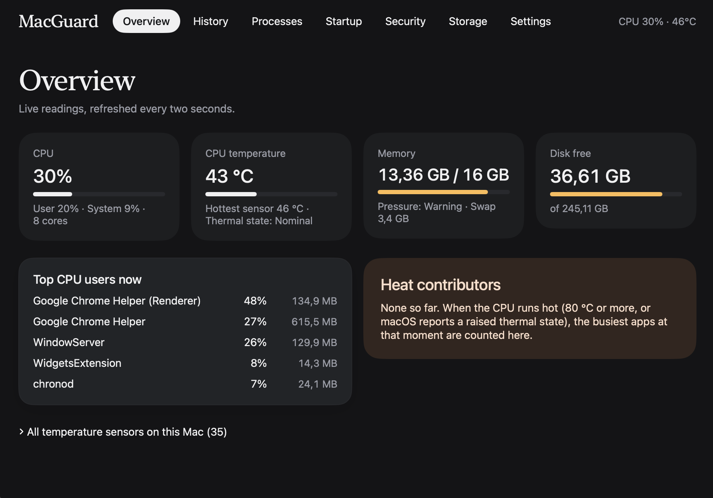
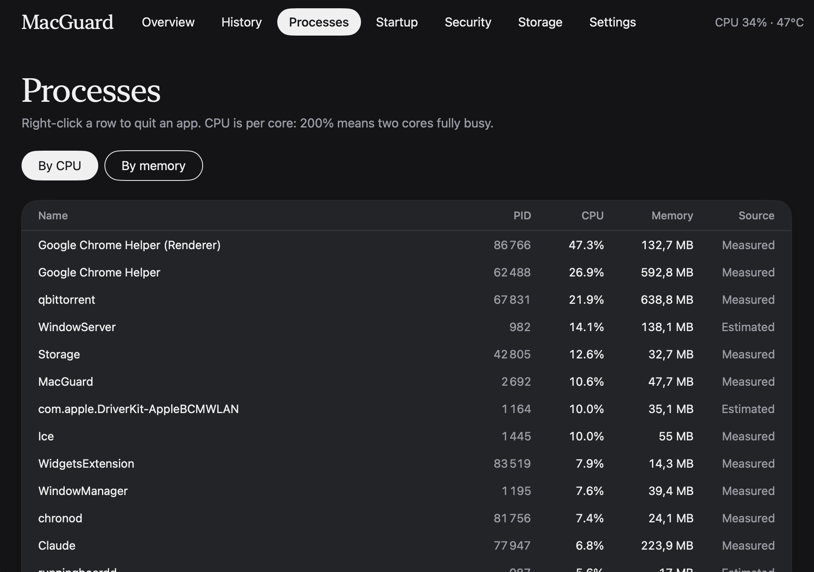
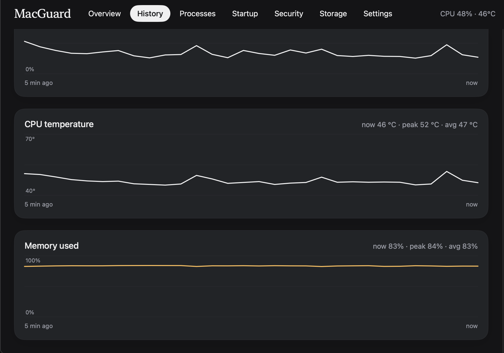
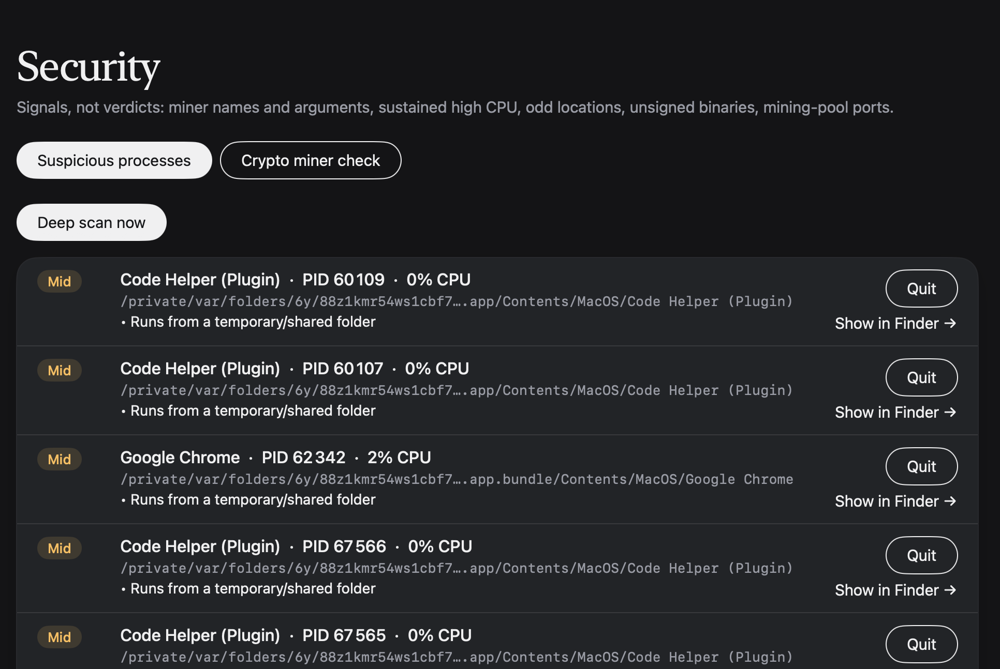
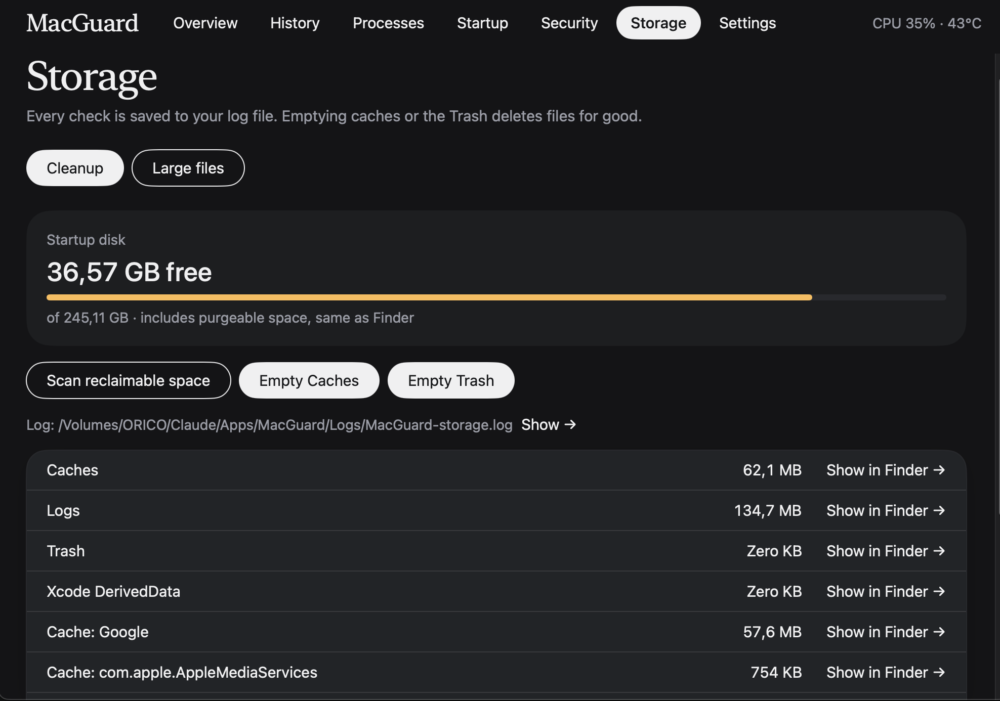
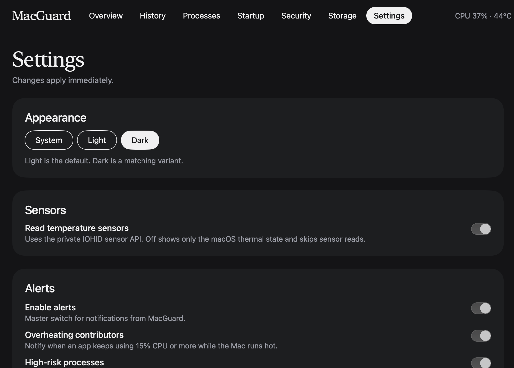

# MacGuard

Lightweight native monitor for Apple Silicon (M1–M4): CPU, RAM, temperature, top processes (right-click to quit), startup items, miner indicators, storage (empty caches/Trash, logs), alerts and settings.
Swift + SwiftUI, built with Command Line Tools only (no Xcode).

## Screenshots

| Overview | Processes |
|---|---|
|  |  |

| History | Security |
|---|---|
|  |  |

| Storage | Settings |
|---|---|
|  |  |

## Build

```bash
xcode-select --install        # once, if `swift --version` fails
cd MacGuard
chmod +x build.sh && ./build.sh
./build/MacGuard.app/Contents/MacOS/MacGuard --selftest   # check numbers vs Activity Monitor
open build/MacGuard.app
```

First launch of an ad-hoc signed app: right-click > Open if Gatekeeper complains.

## Features
- **Overview**: CPU, memory (with pressure), temperatures, disk, hottest processes.
- **History**: CPU, temperature and memory graphs for the last 15 minutes or hour.
- **Processes**: right-click to Quit or Force Quit; overheating contributors with alerts.
- **Startup**: LaunchAgents/LaunchDaemons with signature and risk checks.
- **Security**: suspicious processes and a seven-check crypto miner detector (manual and every 30 minutes).
- **Battery**: charge, power draw in watts, health and cycles, temperature, apps likely draining it.
- **Network**: whole-Mac download/upload and per-app usage.
- **Notch popover**: hover next to the notch for a live mini dashboard (can be turned off in Settings).
- **Storage**: near-instant free-space check, empty caches/Trash, large files finder, logs to a folder you choose.
- **Settings**: theme, sensors, alerts, background running, start at login.

See [CHANGELOG.md](CHANGELOG.md) for what changed in each version.

## How the data is read (and why)

| Metric | Source | Notes |
|---|---|---|
| CPU % | Mach `host_processor_info` tick deltas | Same source as Activity Monitor |
| Memory | `host_statistics64` | Used = App + Wired + Compressed (Activity Monitor definition); pressure from `kern.memorystatus_vm_pressure_level` |
| Per-process CPU/RAM | `proc_pid_rusage` | CPU ticks converted with `mach_timebase_info` (125/3 on Apple Silicon). Root/other-user processes fall back to `ps` and are labelled "Estimated" |
| Temperature | IOHIDEventSystem (private, loaded with dlsym) | Same route as macmon/Stats. Falls back to public `ProcessInfo.thermalState`. No separate motherboard sensor exists on Apple Silicon |
| Battery | `AppleSmartBattery` in the IO registry (IOKit) | Health = maximum capacity / design capacity; watts = voltage x current |
| Network | Interface counters (`getifaddrs`) for totals; `nettop` for per-app | Per-app sampling runs only while the Network tab is open |
| Notch | `NSScreen.safeAreaInsets` and auxiliary top areas | Real notch size in points, so it adapts to every MacBook and display setting |
| Startup items | LaunchAgents/LaunchDaemons plists + in-process code-signature check | `sfltool dumpbtm` needs root, so not used |
| Miner indicators | Names/arguments, sustained CPU, odd paths, unsigned binary, pool ports (`lsof`) | Signals, not verdicts |
| Storage | `URLResourceValues` | Read-only; never deletes |

## Weight / safety choices
- Samples every 2 s with the window visible, 5 s when hidden; no animations.
- Private sensor API is resolved at runtime; if missing, the app shows "n/a" instead of crashing.
- Heavy work (startup scan, deep scan, `lsof`) runs only on demand or when a process is already busy.

## Known limits
- Cannot see inside root processes beyond `ps` estimates, and cannot block anything (needs Apple's Endpoint Security entitlement).
- Temperature sensor names differ per chip; `--selftest` and the Overview "All temperature sensors" list show what your Mac exposes.
- Trash/Library scans may need Full Disk Access to report full sizes.
- Complements, not replaces, Objective-See's KnockKnock / BlockBlock / LuLu.

## Contributing

Contributions and ideas are welcome. I'm open to listening to anyone who wants to help.

- **Want a feature?** [Open an issue](https://github.com/aminerochdi1/MacGuard/issues/new) with the label `wanted feature`. Say what you need and why, and include your Mac model and macOS version if it's hardware-related.
- **Found a bug or a problem?** [Open an issue](https://github.com/aminerochdi1/MacGuard/issues/new) with the label `bug`. Include the steps to reproduce, what you expected, and the output of `./build/MacGuard.app/Contents/MacOS/MacGuard --selftest` if numbers look wrong.
- **Installation or build problem?** Open an issue with the label `installation`. Include your Mac model, macOS version, the output of `swift --version`, and the full terminal output of `./build.sh`.
- **Want to code it?** Fork the repo, create a branch, make one focused change, and open a pull request describing what changed and how you tested it.

Ground rules:
- Keep it lightweight: no heavy dependencies, no animations, no background work that isn't needed.
- Read-only by default; anything that deletes or kills must ask for confirmation first.
- Keep it crash-safe: private APIs are resolved at runtime and fail to "n/a".
- Update this README with every user-facing feature.
- Build with Command Line Tools only (no Xcode project required).

Good first ideas are listed under the `wanted feature` label in Issues.

## Speed: storage checks
Storage checks are close to instant in everyday use, noticeably faster than the native macOS storage screen, which can take a long time to calculate and index folders. In hands-on testing on an M2 MacBook (not a formal benchmark) the disk-free figure and the cleanup scan came back almost immediately.

Why it is fast:
- Free space is read straight from the volume (`URLResourceValues`), with no indexing step.
- The cleanup scan only measures a few known folders (Caches, Logs, Trash, Xcode DerivedData) and the 8 biggest cache folders.
- Work runs in the background, so the window never freezes, and the Large files scan can be stopped at any time.

Large files scans walk every file in the chosen folder, so a huge folder or drive still takes longer than the cleanup scan.
